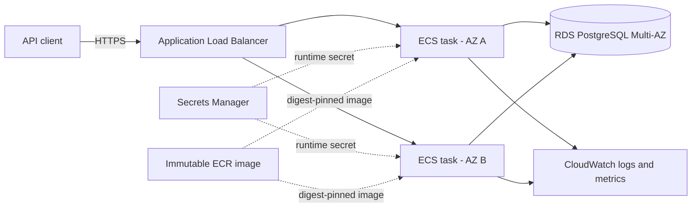

# M-PESA Africa DevOps Case Study

This repository contains a small API that will be used to demonstrate containerization, CI/CD, infrastructure as code, and operational practices.

## Current application

The application is a Node.js HTTP service with three endpoints:

- `GET /` returns basic service information.
- `GET /health` returns the service health status.
- `GET /ready` checks whether the database is available to serve traffic.

## Run locally

Requirements:

- Node.js 24 or newer

Start the API:

```bash
npm start
```

The service listens on `0.0.0.0:3000` by default and shuts down gracefully when it receives `SIGINT` or `SIGTERM`.

| Variable | Default | Description |
| --- | --- | --- |
| `HOST` | `0.0.0.0` | Interface on which the server listens |
| `LOG_LEVEL` | `info` | Log level: `info`, `error`, or `silent` |
| `PORT` | `3000` | HTTP port |
| `SHUTDOWN_TIMEOUT_MS` | `10000` | Maximum graceful-shutdown time |
| `DATABASE_URL` | none | PostgreSQL connection URL used by the readiness check |
| `DB_CONNECT_TIMEOUT_MS` | `2000` | Database connection timeout |
| `DB_POOL_MAX` | `10` | Maximum number of database connections |

Without `DATABASE_URL`, the API still starts and its liveness endpoint remains available, but `/ready` returns HTTP `503`.

Requests are logged as JSON and include a generated request ID, response status, and duration. The same request ID is returned in the `x-request-id` response header.

Run the tests:

```bash
npm test
```

Run lint checks and produce a test coverage report:

```bash
npm run lint
npm run test:coverage
```

## Build the application image

Build the production image:

```bash
docker build --target runtime -t mpa-devops-case-study:local .
```

The Dockerfile also provides a `test` target that runs linting and tests during the build:

```bash
docker build --target test .
```

## Run the complete local environment

The local environment includes Nginx, the API, and PostgreSQL. Copy the example configuration and replace the placeholder database password:

```bash
cp .env.example .env
```

On PowerShell, use `Copy-Item .env.example .env` instead.

Start the environment:

```bash
docker compose up --build
```

The API is available through Nginx at `http://localhost:8080`. The application and database ports are not published to the host.

The application and proxy run with read-only filesystems, dropped Linux capabilities, bounded resources, and rotated container logs. PostgreSQL data is stored in the named `postgres-data` volume.

Check the endpoints:

```bash
curl http://localhost:8080/health
curl http://localhost:8080/ready
```

Stop the environment:

```bash
docker compose down
```

Add `--volumes` only when you intentionally want to delete the local PostgreSQL data volume.

## Pull request checks

Pull requests to `main` run automated validation in GitHub Actions. The workflow:

1. Installs dependencies from the committed lockfile.
2. Runs linting, test coverage, and a dependency audit against a real PostgreSQL service.
3. Builds both the test and production container targets.
4. Scans the repository and runtime image for high or critical vulnerabilities, exposed secrets, and unsafe configuration.
5. Runs CodeQL static analysis for JavaScript.

The workflow uses read-only repository access by default, pins actions to immutable commit SHAs, does not expose deployment credentials, and cancels superseded runs.

Merges to `main` also run the image publishing workflow. After validation and vulnerability scanning, it uses GitHub OIDC to obtain short-lived AWS credentials and pushes a commit-SHA-tagged image to Amazon ECR. See [image publishing configuration](docs/image-publishing.md) for the required repository variables and least-privilege IAM permissions.

## Infrastructure design

The [AWS reference architecture](infrastructure/README.md) models a secure and horizontally scalable ECS Fargate deployment across multiple availability zones, with an Application Load Balancer, autoscaling, isolated PostgreSQL, encrypted storage, immutable images, least-privilege IAM, and centralized logs.

Infrastructure automation is validation-only. GitHub Actions formats, validates, and scans the Terraform without AWS credentials, remote state, planning, applying, or creating resources.



## Delivery and rollback

The delivery process separates validation, artifact publication, and production changes:

1. Pull requests run linting, tests, dependency auditing, container builds, Trivy scans, CodeQL, and Terraform validation.
2. A merge to `main` validates, scans, generates an SBOM, and conditionally publishes an image tagged with the commit SHA. Publishing uses short-lived AWS credentials and is skipped when repository variables are absent.
3. Production deployment is manual. An operator selects a market and supplies an ECR image pinned to its digest. The corresponding protected GitHub environment must approve the job before it can obtain a market-scoped AWS role.
4. ECS performs a zero-downtime rolling deployment with its circuit breaker enabled. The workflow checks service health for up to five minutes and restores the previous task definition if verification fails.
5. An operator can also select `rollback` and provide a previous task-definition ARN. The workflow verifies that it belongs to the active service family before deployment.

Create one protected GitHub environment for each market (`production-kenya`, `production-tanzania`, `production-lesotho`, `production-ethiopia`, `production-mozambique`, and `production-drc`). Each environment should require reviewers and define only its own account, region, deployment-role, cluster, service, and container-name variables. Normal pushes never invoke the production workflow.

## Assumptions and further improvement

This reference assumes each market has an isolated AWS account or workload boundary so transaction data and credentials remain in-country. Images are promoted by digest between environments, application tasks are stateless, database changes remain backward compatible during rolling releases, and DNS and certificates already exist.

With more time, the next improvement would be automated observability and recovery validation: service-level objectives, payment-path synthetic checks, actionable alerts, database restore exercises, and scheduled load tests before salary-date traffic peaks.
